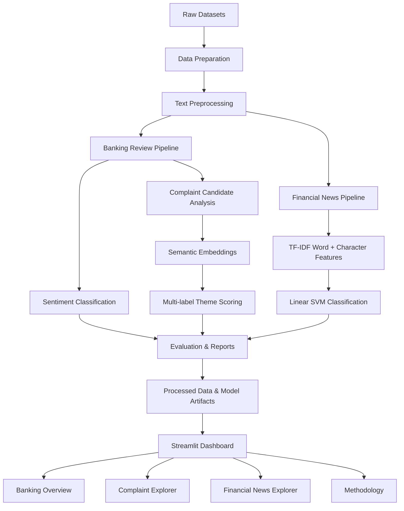

# Financial Sentiment Intelligence

<p align="center">
  <strong>An NLP-powered platform for banking customer sentiment, complaint theme discovery, and financial news sentiment analysis.</strong>
</p>

<p align="center">
  
  
  
  
  
  
</p>

---

## Overview

**Financial Sentiment Intelligence** is an end-to-end Natural Language Processing (NLP) project designed to extract useful insights from two types of financial text data:

1. **Banking app customer reviews** — understand customer sentiment and identify recurring complaint themes.
2. **Financial news** — classify financial news statements into negative, neutral, and positive sentiment.

The platform combines traditional machine learning, TF-IDF text representations, semantic similarity, multi-label theme scoring, data quality checks, and an interactive Streamlit dashboard.

The goal is to transform unstructured financial text into structured information that can support customer experience analysis and financial text research.

> Banking customer sentiment and financial news sentiment are separate analytical tasks. Neither should be interpreted as a direct prediction of financial market direction or investment performance.

## Key Features

### 1. Banking Customer Sentiment

- Banking app review preprocessing and quality auditing.
- Positive, neutral, and negative sentiment classification.
- Chronological train, validation, and test splitting.
- TF-IDF-based text classification.
- Model comparison and held-out evaluation.
- Review-level exploration through the dashboard.

### 2. Complaint Theme Intelligence

Semantic analysis of banking customer complaints using sentence embeddings and similarity-based theme assignment.

The platform investigates nine complaint categories:

| Theme | Description |
|---|---|
| App Performance | Crashes, bugs, slow loading, technical issues |
| Login & Authentication | Login failures and authentication problems |
| Account Restriction | Frozen, blocked, or restricted accounts |
| Fraud & Security | Suspicious activity and security concerns |
| Money Transfer | Transfers, payments, and transaction delays |
| Customer Support | Support availability and service quality |
| Card Payment | Card declines and payment problems |
| Features & Usability | App features and user experience |
| Trading & Investment | Investment and trading-related issues |

Features include:

- Complaint candidate identification.
- Semantic classification using sentence embeddings.
- Multi-label theme similarity scoring.
- Theme coverage analysis.
- Unassigned, single-theme, and multi-theme review analysis.
- Theme-level and banking-app-level summaries.

**Important:** Theme similarity scores are not calibrated probabilities. A review may belong to multiple themes, and the assigned themes have not been fully validated against a large human-annotated ground-truth dataset.

### 3. Financial News Sentiment

A separate NLP pipeline classifies financial news into:

- Negative
- Neutral
- Positive

Model development includes:

- Word-level TF-IDF features.
- Character-level TF-IDF features.
- Logistic Regression and Linear SVM experiments.
- Validation-based model selection.
- Frozen held-out test evaluation.
- Confusion matrix and class-level performance analysis.

## Model Performance

The following results come from the project's held-out evaluations.

### Banking Review Sentiment

| Metric | Result |
|---|---:|
| Test Accuracy | **93.73%** |
| Balanced Accuracy | 89.36% |
| Macro F1-score | 87.43% |
| Weighted F1-score | 93.87% |

Primary model: TF-IDF + Linear SVM.

The target is the dataset's existing review sentiment annotation. These labels are not independently verified human ground truth.

### Financial News Sentiment

| Metric | Result |
|---|---:|
| Test Accuracy | **75.62%** |
| Macro Precision | 72.14% |
| Macro Recall | 69.09% |
| Macro F1-score | **70.44%** |
| Weighted F1-score | 75.31% |

Selected model: Word + Character TF-IDF with Linear SVM (`C=0.5`).

### Financial News: Class-level Results

| Class | Precision | Recall | F1-score |
|---|---:|---:|---:|
| Negative | 0.69 | 0.59 | 0.64 |
| Neutral | 0.81 | 0.85 | 0.83 |
| Positive | 0.67 | 0.63 | 0.65 |

The neutral class performs better than the positive and negative classes. This indicates that identifying subtle financial sentiment remains a challenge.

## System Architecture



## Technology Stack

| Category | Technologies |
|---|---|
| Programming | Python |
| Data Processing | Pandas, NumPy, PyArrow |
| Machine Learning | Scikit-learn |
| NLP | TF-IDF, Sentence Transformers |
| Semantic Embeddings | all-MiniLM-L6-v2 |
| Visualization | Plotly |
| Dashboard | Streamlit |
| Model Persistence | Joblib |
| Testing | Pytest |
| Data Storage | Parquet, CSV, JSON |
| Version Control | Git |

## Project Structure

```text
financial-sentiment-intelligence/
│
├── config/
│
├── dashboard/
│   └── app.py
│
├── data/
│   ├── raw/
│   ├── interim/
│   └── processed/
│
├── models/
│
├── notebooks/
│
├── reports/
│
├── src/
│   ├── prepare_data.py
│   ├── text_preprocessing.py
│   ├── create_banking_review_splits.py
│   │
│   ├── train_banking_review_models.py
│   ├── train_banking_text_sentiment_models.py
│   ├── train_financial_news_models.py
│   │
│   ├── prepare_complaint_dataset.py
│   ├── build_complaint_cohorts.py
│   ├── semantic_complaint_classification.py
│   ├── prepare_multilabel_theme_scores.py
│   ├── finalize_complaint_themes.py
│   │
│   ├── prepare_dashboard_data.py
│   └── ... analysis and validation scripts
│
├── tests/
│   ├── test_text_preprocessing.py
│   ├── test_complaint_themes.py
│   └── test_dashboard_data.py
│
├── .gitignore
├── requirements.txt
└── README.md
```

## Datasets

### Banking App Reviews

Source: [Banking App Reviews Dataset](https://huggingface.co/datasets/pcatarino88/banking-app-reviews-data)

Project dataset characteristics:

- Original records: 703,563
- Usable records after removing missing/empty text: 703,493
- Banking applications: 6
- Original review sentiment annotations and star ratings are available.

**Licensing note:** The dataset's redistribution and commercial-use permissions must be verified with its provider. Do not assume the data can be redistributed.

### Financial News

Source: [Financial PhraseBank](https://huggingface.co/datasets/yiogrdg/FinancialPhraseBank)

- Total records: 4,840
- Training: 3,872
- Validation: 484
- Testing: 484
- Classes: Negative, Neutral, Positive

The dataset is distributed under **CC BY-NC-SA 4.0**. Commercial reuse is restricted by its non-commercial condition.

Reference:

Malo, P., Sinha, A., Korhonen, P., Wallenius, J., & Takala, P. (2014). *Good debt or bad debt: Detecting semantic orientations in economic texts.* Journal of the Association for Information Science and Technology, 65, 782–796.

## Installation

### 1. Clone the repository

```bash
git clone <YOUR_REPOSITORY_URL>
cd financial-sentiment-intelligence
```

### 2. Create a virtual environment

Windows PowerShell:

```powershell
python -m venv .venv
.venv\Scripts\Activate.ps1
```

### 3. Install dependencies

```powershell
python -m pip install --upgrade pip
pip install -r requirements.txt
```

### 4. Prepare the datasets

Obtain the datasets from their respective sources and place the required Parquet files in `data/raw/`.

Expected raw files:

```text
data/raw/
├── banking_app_reviews.parquet
├── financial_news_train.parquet
├── financial_news_validation.parquet
└── financial_news_test.parquet
```

The raw data and generated model/report artifacts are excluded from Git.

## Running the Project

### Data Preparation

```powershell
python src/prepare_data.py
```

### Text Preprocessing

```powershell
python src/text_preprocessing.py
```

### Banking Review Splits

```powershell
python src/create_banking_review_splits.py
```

### Model Training

```powershell
python src/train_banking_text_sentiment_models.py
python src/train_financial_news_models.py
```

The complaint-theme workflow also uses intermediate datasets generated by its cohort, clustering, semantic classification, and theme-scoring stages. These stages must be executed in dependency order before finalizing complaint themes and preparing dashboard data.

Relevant scripts include:

```text
src/prepare_complaint_dataset.py
src/build_complaint_cohorts.py
src/discover_complaint_themes.py
src/semantic_complaint_classification.py
src/prepare_multilabel_theme_scores.py
src/finalize_complaint_themes.py
src/prepare_dashboard_data.py
```

Some analysis and validation scripts depend on intermediate artifacts created during experimentation. This repository does not yet provide a single automated command for reproducing every research experiment.

## Launching the Dashboard

After generating the required processed datasets and reports:

```powershell
streamlit run dashboard/app.py
```

Streamlit will provide a local URL, normally:

```text
http://localhost:8501
```

### Dashboard Sections

- **Banking Overview:** Review statistics, ratings, and app-level comparisons.
- **Complaint Explorer:** Explore complaint themes and individual reviews.
- **Financial News:** Review sentiment metrics, actual-versus-predicted distributions, confusion matrix, and searchable predictions.
- **Methodology:** Understand the data and analytical approach.

## Testing

Run the complete test suite:

```powershell
python -m pytest -v
```

Current test coverage:

| Test Module | Focus |
|---|---|
| `test_text_preprocessing.py` | Text cleaning, Unicode, emoji, missing values |
| `test_complaint_themes.py` | Theme integrity and multi-label consistency |
| `test_dashboard_data.py` | Dashboard dataset integrity and consistency |

**Latest verified result: 34 tests passed.**

## Methodology & Limitations

This project is an analytical research and portfolio project. Its results should be interpreted with the following limitations in mind:

1. **Banking sentiment labels:** Existing dataset annotations are not independently verified human ground truth.
2. **Rating-derived sentiment:** Star ratings are satisfaction proxies, not direct evidence of the sentiment expressed in review text.
3. **Complaint candidates:** Negative labels and low ratings help identify candidate complaints; they do not establish that every selected review is a verified complaint.
4. **Semantic classification:** Similarity scores represent semantic closeness, not calibrated probabilities.
5. **Multi-label themes:** A review can belong to more than one theme. Theme counts are therefore overlapping.
6. **Unassigned reviews:** A review without a theme above the chosen threshold is not necessarily issue-free.
7. **Financial news:** The dataset is relatively small and performance may vary on newer or different financial news sources.
8. **Market interpretation:** News sentiment classification does not predict stock prices, returns, or investment outcomes.

## Future Improvements

- Human-annotated complaint validation dataset.
- Theme-specific threshold calibration.
- More robust multilingual sentiment analysis.
- Temporal drift and model monitoring.
- Explainability for individual predictions.
- API deployment for inference.
- Automated end-to-end pipeline orchestration.
- CI workflow for automated testing.
- Dashboard screenshots and deployment.

## Project Goals

This project demonstrates practical experience in:

- NLP and text classification.
- Financial data analysis.
- Semantic similarity and embeddings.
- Multi-label classification.
- Model evaluation and error analysis.
- Data quality engineering.
- Interactive analytics dashboards.
- Reproducible ML development and testing.

---

<p align="center">
  <strong>Financial Sentiment Intelligence</strong><br/>
  Turning financial text into structured analytical insights.
</p>
